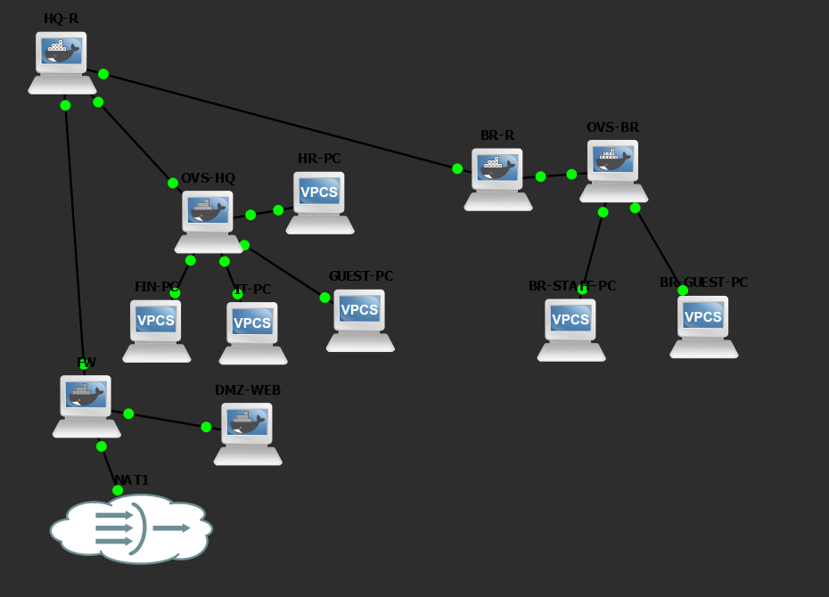
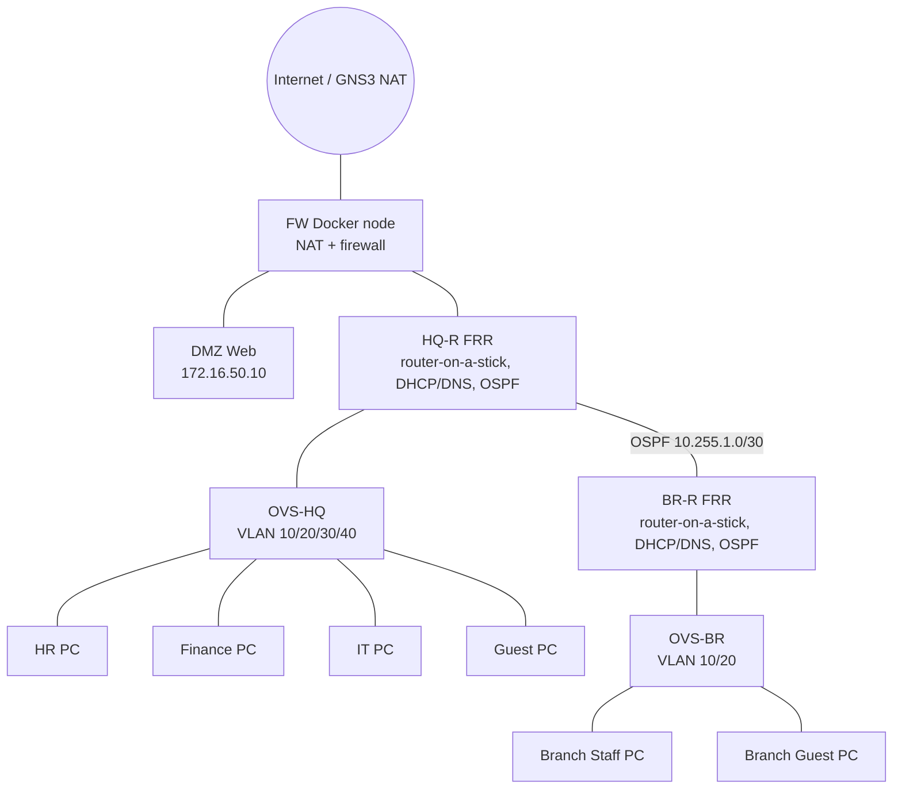

# Enterprise Network Simulation Lab (GNS3, $0, no vendor images)

A complete two-site office network you can build for free in GNS3 using only open-source
devices (FRRouting, Open vSwitch, iptables, dnsmasq, nginx, VPCS). Designed to run on a **16 GB laptop**
without heavy VMs, so it stays cool.

**Objective:** design a full office network, secure it, then break it on purpose and troubleshoot.

## Topology (live GNS3 project)



### Logical diagram



## Features

| Area | What you get |
|---|---|
| Switching | VLANs, 802.1Q trunks (Open vSwitch) |
| Routing | Inter-VLAN routing (router-on-a-stick), OSPF between HQ and Branch, default route origination |
| Services | DHCP + DNS (dnsmasq), DMZ web server (nginx) |
| Security | Guest isolation, HR/Finance separation, default-deny DMZ firewall, NAT |
| Skills | 10 break/fix troubleshooting labs with diagnosis steps |

## Tested

Built and verified on GNS3 2.2.61 (GNS3 VM with 4 vCPU / 4 GB RAM).

| Test | Result |
|---|---|
| DHCP in all VLANs (HQ and Branch) | Pass |
| HR to IT allowed, HR to Finance blocked | Pass |
| IT to Finance allowed | Pass |
| Guest isolated from internal networks (HQ and Branch) | Pass |
| Inside to DMZ web and DNS (`web.lab.local`) | Pass |
| NAT to internet | Pass |
| OSPF Full adjacency HQ-R and BR-R, default route learned | Pass |
| HQ to Branch connectivity | Pass |

Full checklist: [docs/test-plan.md](docs/test-plan.md). Pitfalls and fixes: [docs/known-issues.md](docs/known-issues.md).

## Quick start

1. Install GNS3 + GNS3 VM. Follow [docs/setup-guide.md](docs/setup-guide.md).
2. Build the Docker image inside the GNS3 VM: `docker build -f docker/Dockerfile -t ent-lab/node .`
3. Wire devices using [docs/ip-plan-and-wiring.md](docs/ip-plan-and-wiring.md).
4. Run [docs/test-plan.md](docs/test-plan.md) to verify everything works.
5. Practice with [docs/troubleshooting-labs.md](docs/troubleshooting-labs.md).

## Repo layout

```
docker/        Dockerfile + role scripts (hq.sh, branch.sh, fw.sh, web.sh)
configs/       FRR, dnsmasq, OVS, VPCS configs (+ optional VyOS config)
docs/          Setup, IP plan, test plan, troubleshooting labs, known issues
screenshots/   Topology and test evidence
```

## Keeping your laptop cool

Everything here is Docker/VPCS based (about 3-5 GB RAM). Start only the nodes you need,
stop the project when idle, and watch temperatures (HWMonitor / Core Temp).

## Roadmap

- [ ] Suricata IDS container on a mirrored port
- [ ] Wazuh SIEM + log forwarding
- [ ] Site-to-site VPN (WireGuard/IPsec)
- [ ] Port security / DHCP snooping on OVS
- [ ] Exported `.gns3project` file

## Contributing

Found a command that differs on your GNS3 or FRR version? Open an issue or PR.

## License

MIT